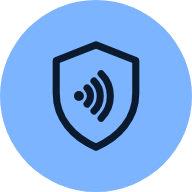

<p align="center"></p>

<h1 align="center">ChipID</h1>

<p align="center">Read the chip in a passport or ID card with an Android phone, and verify that the data and the chip are genuine. Fully offline.</p>

---

ChipID reads ICAO 9303 eMRTDs (biometric passports and ID cards from 100+ countries) over NFC. It
scans the MRZ with the camera, opens the chip, shows the holder data and the photo stored on the
chip, and runs the same cryptographic checks a border e-gate runs on the document.

## Features

- **MRZ scanning** with the camera, on-device OCR. Passports (TD3) and ID cards (TD1). A scan is
  accepted only when every ICAO check digit verifies and two consecutive frames agree.
- **Access control:** PACE (MRZ or 6-digit CAN), falling back to BAC.
- **Reads** EF.SOD and every data group it lists: DG1 (MRZ data), DG2 (face image), DG11/DG12
  (extra holder and document details), DG14, DG15. DG3/DG4 (fingerprints, iris) are never requested.
- **Verification**

  | Check | Standard | Proves |
  |---|---|---|
  | Passive Authentication | ICAO 9303-11 §5.1 | Data group hashes match the signed SOD; SOD signed by the Document Signer; DSC signed by the issuing country's CSCA. The data is the state's and unaltered |
  | Active Authentication | ICAO 9303-11 §6.1 | The chip signs a fresh challenge with the DG15 key (RSA ISO 9796-2 or plain ECDSA). Not a clone |
  | Chip Authentication | ICAO 9303-11 §6.2, BSI TR-03110 | (EC)DH with the DG14 key, then a re-read under the new session keys. Not a clone |

- **Trust list:** the German BSI CSCA master list (600+ certificates, 117 countries), fetched at build
  time; its CMS signature is verified on the phone. Extra anchors can be added at runtime.

## Privacy

- **No network access.** The app has no `INTERNET` permission (libraries that ask for it are
  overridden in the manifest), so Android blocks every connection. Verify any build with
  `aapt2 dump permissions app-debug.apk`: only `NFC` and `CAMERA`.
- Camera frames are recognised on the phone and never stored.
- The access key and the chip data stay in memory. Nothing is written unless you tap *Export raw
  files*; *Delete exported files* removes all exports. Excluded from backups.

See [SECURITY.md](SECURITY.md) for the threat model and what a green result does and does not mean.

## Build

Requirements: JDK 17+, Android SDK (compileSdk 36), an NFC phone (Android 8+).

```bash
./gradlew :app:testDebugUnitTest   # JVM tests: PA chain, AA (RSA ISO 9796-2, ECDSA), MRZ TD1/TD3, master list
./gradlew :app:assembleDebug       # first build downloads the BSI master list into assets/
adb install -r app/build/outputs/apk/debug/app-debug.apk
```

Add trust anchors without rebuilding by copying `.ml`, `.der`, `.cer`, `.crt` or `.pem` files to
`/sdcard/Android/data/com.ismoilovdev.chipid/files/csca/`.

## How it is built

| Path | What |
|---|---|
| `core/Mrz.kt` | MRZ finder and parser with per-field OCR repair and check-digit validation |
| `core/PassiveAuth.kt` | SOD hash check, CMS signature, DSC → CSCA chain |
| `core/ActiveAuth.kt` | AA signature verification (ISO 9796-2 scheme 1, plain ECDSA) |
| `core/MasterList.kt` | ICAO CSCA master list parser and signature check |
| `reader/ChipReader.kt` | NFC session: PACE/BAC, file reads, AA, CA, progress |
| `scan/MrzAnalyzer.kt` | CameraX frames → on-device OCR → MRZ |
| `ui/` | Jetpack Compose screens |

Stack: Kotlin, Jetpack Compose, CameraX, ML Kit text recognition (bundled), JMRTD, SCUBA, Bouncy
Castle (installed as provider #1 because Android's stripped "BC" lacks brainpool curves and
explicit EC parameters).

### Notes from real devices

- On Samsung phones, opening the camera stops NFC polling, and closing it restarts the system's
  default discovery, which silently drops an app's reader mode. ChipID re-arms reader mode when the
  camera is released.

## Limits

- JPEG 2000 face images are not decoded on the phone yet; export and open `face0.jp2` with
  `opj_decompress`.
- No face matching, no CRL/revocation checks, no EAC terminal authentication, no PACE-CAM.

## Disclaimer

ChipID is an independent project, not affiliated with ICAO, the BSI or any issuing state. Use it only
with documents you hold and are allowed to read. A green result is a technical check of the chip,
not an official identity verification.

## License

MIT, see [LICENSE](LICENSE). Third-party components and their licenses: [THIRD_PARTY.md](THIRD_PARTY.md).
